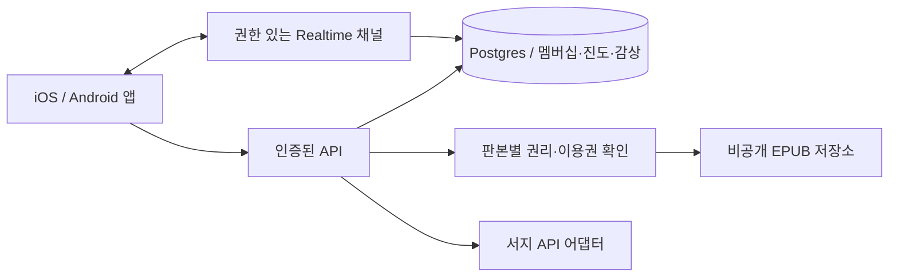

# 기술 구조와 다음 구현 순서

## 현재 적용

Expo 57 + React Native + TypeScript. iOS·Android 공용 UI, 동일 코드의 웹 버전은 빠른 검토용이다. 현재 원문은 자체 샘플 데이터, 기록은 AsyncStorage 로컬 저장. 실제 계정·서버·EPUB/DRM·결제는 연결하지 않았다.

Expo 관리 버전과 lockfile을 사용한다. 공용 리더 인터페이스를 둔 후 EPUB 엔진을 교체하도록 한다. UI 초기에 스타일 엔진 여러 개를 추가하지 않고 RN StyleSheet로 토큰을 구현한다. 소스 복사가 필요한 Reusables는 필요한 컴포넌트가 생길 때만 도입한다.

## 목표 구조 (미구현)

Supabase는 Auth/Postgres/Storage/Realtime 후보이다. 설치/연결한 것으로 간주하지 않는다. RLS는 데이터베이스가 각 사용자가 접근할 수 있는 행을 제한하는 기능이며, 방 멤버와 원문 열람권을 분리해 검사한다. [RLS](https://supabase.com/docs/guides/database/postgres/row-level-security), [Realtime 권한](https://supabase.com/docs/guides/realtime/authorization)

## 데이터의 경계

| 데이터 | 키/연결 | 실서비스 규칙 |
|---|---|---|
| Work | 작품 ID | 작품과 번역·출판 판본을 구분 |
| Edition | 작품, ISBN, 파일 해시, 언어 | EPUB 위치는 판본/파일 버전과 함께 저장 |
| ContentRight | 판본, 허용행위/지역/기간 | 근거 없는 본문 전달 금지 |
| Entitlement | 사용자+판본+기간 | 방 참가와 별개의 열람권 |
| Room / Membership | 방+사용자+역할+상태 | 나가기/차단 후 API와 채널 모두 차단 |
| Progress | 사용자+판본, locator, revision | 마지막 위치와 최대로 읽은 위치 분리 |
| Annotation | 판본/장/locator, 작성자, 공개범위 | 개인 기록 기본 비공개, 공개 시 사용자가 선택 |
| Reading session | 방, 시작/종료, 선택적 presence | 본문이나 원문 파일을 실시간 전송하지 않음 |

페이지 수는 화면·글꼴마다 바뀐다. 내부 EPUB는 stable locator/CFI와 원문 해시를 사용한다. 종이책/외부 플랫폼은 사용자 장·진도 수동 입력으로 시작한다. 판본이 다른 자동 하이라이트 연결은 신뢰할 수 있는 매핑 전까지 지원하지 않는다.

## 동기화 규칙

- Postgres의 확정 기록을 기준으로 삼고 Realtime은 변경 알림에 사용한다.
- 새 감상은 클라이언트 생성 event ID로 중복 전송 방지, 실패 표시와 재시도 제공.
- 재접속 때 마지막 cursor 이후 조회 또는 최신 상태 조회. 알림이 누락돼도 데이터 복구 가능하게 한다.
- 읽은 최대 지점은 같은 판본에서 증가하는 값, 마지막 읽던 위치는 별도 revision 기반 업데이트. 단순 최대 퍼센트만으로 이어읽기를 정하지 않는다.
- 장 순서·멤버십·공개범위 검증은 서버에서 수행한다. 숨긴 대화 본문은 불필요하게 내려보내지 않는다.
- 익명 사용자, 비멤버, 탈퇴 사용자, 차단 사용자, 다른 작성자의 수정 요청, 만료 열람권을 검증 사례에 포함.

## EPUB 엔진 결정

`@epubjs-react-native/core`는 빠른 JS 통합 후보, Readium Swift/Kotlin은 네이티브 리더와 LCP 요구가 생길 때 비교할 후보다. 둘 다 설치만으로 현재 Expo와 호환된다고 단정하지 않는다. [OSS 조사](research/opensource-inventory.md)

기술 실험은 같은 한국어 EPUB로 목차·텍스트 선택·위치 복원·글자 조절·오프라인·접근성·대용량 파일을 비교한다. Readium 연결에는 custom native module과 development build가 필요할 수 있다. LCP는 별도 계약/인증·비용을 수반할 수 있으므로 공개 소스만으로 상용 DRM 완성으로 계산하지 않는다.

## 다음 작업 큐

1. **첫 경험 검증:** 실제 휴대폰에서 단계 0 흐름 확인. 통과 전 backend 기능을 넓히지 않는다.
2. **콘텐츠 파일럿 준비:** 권리 근거가 있는 3~5편 후보와 제휴 제안서 준비.
3. **리더 엔진 실험:** 두 플랫폼·한국어 EPUB 비교 결과를 기록하고 한 가지 선택.
4. **2인 베타:** 계정/멤버십/진도/감상과 서버 권한 검사. 두 실제 기기에서 읽고 주고받기.
5. **출시 준비:** 신고/차단/삭제, 개인정보·저작권 운영, 스토어 결제/계정 정책, 기기 접근성, 성능.

출시 일정은 콘텐츠 계약·리더 호환성·기기 검증 전 확약하지 않는다.
